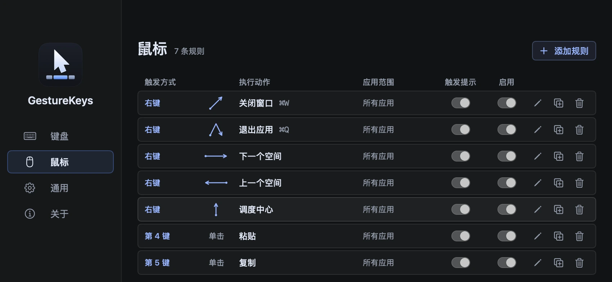

# GestureKeys

GestureKeys 是一个原生 macOS 工具。用键盘快捷键、鼠标点击和手势执行常用操作。规则与诊断日志只保存在本机。

[下载 macOS 版（Apple Silicon）](https://github.com/yinyu985/GestureKeys/releases/latest) · [安装说明](#安装)

<a href="site/assets/rules.webp"></a>
<a href="site/assets/editor.webp"></a>

## 功能

- **键盘快捷键**：使用 macOS 全局热键注册，不监听普通键盘输入。
- **鼠标手势**：按住右键、中键或侧键画轨迹，按形状匹配。支持内置预设（上下左右、两条斜线、字母 C/V/L、数字 2/6/7、小于号/大于号）或手绘。
- **鼠标点击**：单击、双击、多键（右键、中键、第 4/5/6/7/8 键）。
- **按应用生效**：每条规则可以是全局的，也可以只对某个应用生效；同名触发方式下，单应用规则覆盖全局规则。
- **手势轨迹**：可选显示，颜色和粗细可调。
- **改动即生效**：保存规则后自动启用。列表里的「触发提示」只控制是否显示规则名称，不会停用规则。
- **界面与启动**：支持简体中文、英语，跟随 macOS 的应用语言。「通用」可选浅色、深色或跟随系统，也可开启登录时启动。
- **可排查**：本地日志记录权限变化、热键注册失败、输入监听中断、手势匹配结果、动作派发与失败原因。

## 系统要求

- macOS 13 或更新版本
- 预编译版本是 **Apple Silicon（arm64）**，直接下载就能用，不需要构建

## 安装

1. 打开 [Releases](../../releases/latest)，下载 `GestureKeys-<版本>-arm64.zip`。
2. 解压，把 `GestureKeys.app` 拖进「应用程序」，再双击打开。升级时先退出旧版，再替换它。
3. 如果 macOS 提示「无法验证开发者」或拦截打开，这是因为下载版使用 ad-hoc 签名，未做 Apple 公证。确认从本仓库下载后，可到 **系统设置 → 隐私与安全性 → 仍要打开**，或在终端仅对这个应用移除隔离标记：

   ```bash
   xattr -dr com.apple.quarantine /Applications/GestureKeys.app
   ```

## 首次启动

1. **授予权限**：打开「通用」，在「辅助功能」和「输入监控」两处各点一次「授权」，在系统设置里勾选 GestureKeys。
2. 权限到位后规则自动生效，不需要额外点按钮。
3. 关掉设置窗口，应用会继续在菜单栏或程序坞运行（可在「通用 → 应用图标」里改）。

如果缺少权限，窗口底部和诊断日志会提示。更新后如果权限失效，请在系统设置中重新授权。

## 使用

- **添加规则**：在「键盘」或「鼠标」页点「添加规则」。鼠标规则可以先选按键，再选手势 / 单击 / 双击。
- **查看已记录的键**：在规则弹窗里随意按一个键或鼠标键，左下角会短暂显示「当前按下的是：…」，用来确认第 4 键到底是哪个。
- **画手势**：在轨迹板里按住鼠标画一条线，松手后保持原样。列表里显示缩略图，横向过长的轨迹只压缩缩略图，不改原始笔迹。
- **排序**：列表自动按按键和快捷键排序，右键相关规则始终聚在一起。

## 排障

菜单路径：**通用 → 排障 → 在 Finder 中显示**。

日志位置：

```text
~/Library/Logs/GestureKeys/GestureKeys.log
```

- 每行一个 JSON 记录：时间、会话 ID、事件名、字段。
- 单个文件上限约 1 MB，滚动保留 1 份当前日志 + 3 份归档（`GestureKeys.1.log` … `GestureKeys.3.log`）。
- 目录 `0700`、文件 `0600`，只存在本机。
- 不记录普通打字内容、剪贴板内容和鼠标坐标。

同一个 `trace` 字段会把一次触发串起来，例如：

```text
hotkey.received → input.matched → action.open_requested → action.open_failed
```

常用事件：

| 事件 | 含义 |
| --- | --- |
| `app.started` / `app.exiting` | 启动与退出 |
| `input.permissions` | 辅助功能、输入监控、事件投递、Secure Input 状态变化 |
| `monitor.policy` | 为什么监听没开：`missing_permissions`、`rule_conflicts`、`no_enabled_rules` 等 |
| `input.context` | 当前前台应用，以及是否在规则编辑器、快捷键录制或对话框内暂停 |
| `tap.starting` / `tap.started` / `tap.start_failed` | 鼠标事件监听 |
| `tap.recovery` | 系统临时禁用监听后恢复（`timeout` 表示回调超时） |
| `hotkey.registered` / `hotkey.registration_failed` | 快捷键注册结果，含系统错误码 |
| `mouse.received` / `gesture.recognized` | 收到鼠标输入、手势匹配成功及距离 |
| `mouse.no_match` | 没匹配上，`reason` 说明是没规则、形状不符还是多个规则太接近 |
| `mouse.cancelled` | 被取消，`reason` 说明是切了应用、焦点回到设置窗口还是超时 |
| `action.shortcut_posted` | 已把快捷键发出去（只代表已派发，不代表目标应用执行了动作） |
| `action.open_failed` | 打开应用失败，含系统错误域与错误码 |

如果规则完全没反应，按顺序看：`input.permissions` → `monitor.policy` → `tap.started` → `hotkey.registered` / `mouse.received`。

## 已知限制

- **未做 Apple 公证**：macOS 可能拦截首次打开，按上面的安装说明处理。重新构建或更新后可能需要重新授权。
- **绑定右键单击会接管普通右键菜单**：这是功能本身的取舍，建议只对需要的应用生效。
- **手势识别不做旋转归一化**：左划和右划是两条不同的规则。
- **配置备份只保留上一版**：每次保存覆盖 `config-backup-*.json`，不累积历史。

## 数据位置

| 内容 | 路径 |
| --- | --- |
| 规则配置 | `~/Library/Application Support/GestureKeys/config.json` |
| 上一版配置 | `~/Library/Application Support/GestureKeys/config-backup-*.json` |
| 日志 | `~/Library/Logs/GestureKeys/` |

全部只在本机，没有网络请求。

## 项目结构

```text
Sources/GestureCore/     规则模型、手势匹配、配置读写、日志（无 AppKit 依赖）
Sources/GestureKeys/     应用界面、事件监听、热键注册
Tests/GestureCoreTests/  核心检查（独立可执行，不需要 XCTest）
scripts/build.sh         检查 → 构建 → 打包 → 签名 → 安装
scripts/make_icon.swift  生成 AppIcon
site/                   官网静态页面和截图
```

Cloudflare Pages 可连接本仓库的 `main`：根目录 `site`，不设构建命令，输出目录 `.`。可以用 `site/*` 作为构建监视路径，只在网站文件变更时部署。

运行核心检查：

```bash
swift run GestureCoreChecks
```

### 自己构建

需要 Xcode Command Line Tools（`xcode-select --install`）和 Swift 6。

```bash
./scripts/build.sh                           # 构建并装到 /Applications
GESTUREKEYS_INSTALL_DIR= ./scripts/build.sh  # 只构建，不安装
```

脚本依次执行核心检查、release 构建、生成图标、ad-hoc 签名。产物在 `.build/bundle/GestureKeys.app`。自己构建的文件不带隔离标记，不需要 `xattr`。

## 从 BetterAndBetter 迁移

「通用 → 导入」支持 BetterAndBetter 导出的 `.BABPreset`。只导入支持的键盘和普通鼠标规则，不支持的规则会被跳过并给出数量提示。魔术鼠标、触控板和触发角暂不支持。