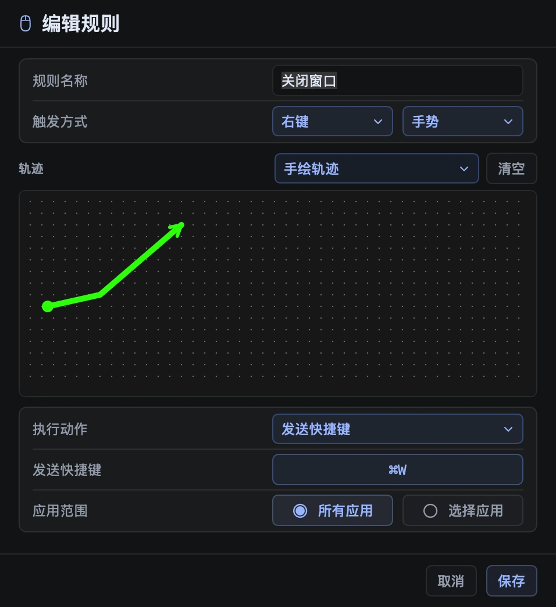

# GestureKeys

用快捷键、鼠标点击或手势操作 Mac。比如在浏览器里按一个快捷键回到页顶，或用鼠标向左划返回上一页。规则可以全局生效，也可以只在指定应用里生效。

**[下载 macOS 版](https://github.com/yinyu985/GestureKeys/releases/latest)** · [安装说明](#安装) · [官网](https://gesturekeys.pages.dev)

下载版适用于 **Apple 芯片（M 系列）**，需要 **macOS 13 或更新版本**。

## 安装

1. 下载 ZIP 并解压，将 `GestureKeys.app` 拖到「应用程序」，然后打开。
2. 在 GestureKeys 的「通用」中，分别为「辅助功能」和「输入监控」点击「授权」，并在系统设置里允许 GestureKeys。
3. 在「键盘」或「鼠标」页点「添加规则」，选择触发方式、要执行的动作和应用范围。保存后即生效。

**升级**：先退出 GestureKeys，再用新版替换「应用程序」里的旧版。原有规则会保留。若新版提示缺少权限，在「通用」中重新授权即可。

## 常见问题

- **macOS 阻止打开**：确认文件来自上方的下载链接后，到「系统设置 → 隐私与安全性」找到 GestureKeys，点击「仍要打开」。
- **`Ctrl+1` 不生效**：macOS 可能将它用于「切换到桌面 1」。可以在「系统设置 → 键盘 → 键盘快捷键 → 调度中心」查看，也可以为 GestureKeys 选一个不同的快捷键。
- **从 BetterAndBetter 迁移**：在「通用 → 导入」选择 `.BABPreset` 文件。不支持的规则会跳过，导入后会提示数量。

规则和诊断日志只保存在本机。排查问题时，可在「通用 → 排障」打开日志所在文件夹。
